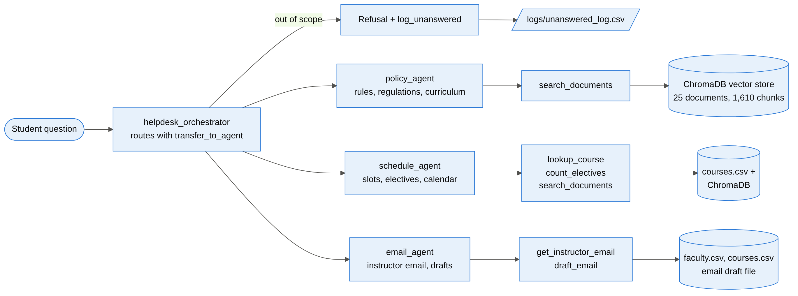
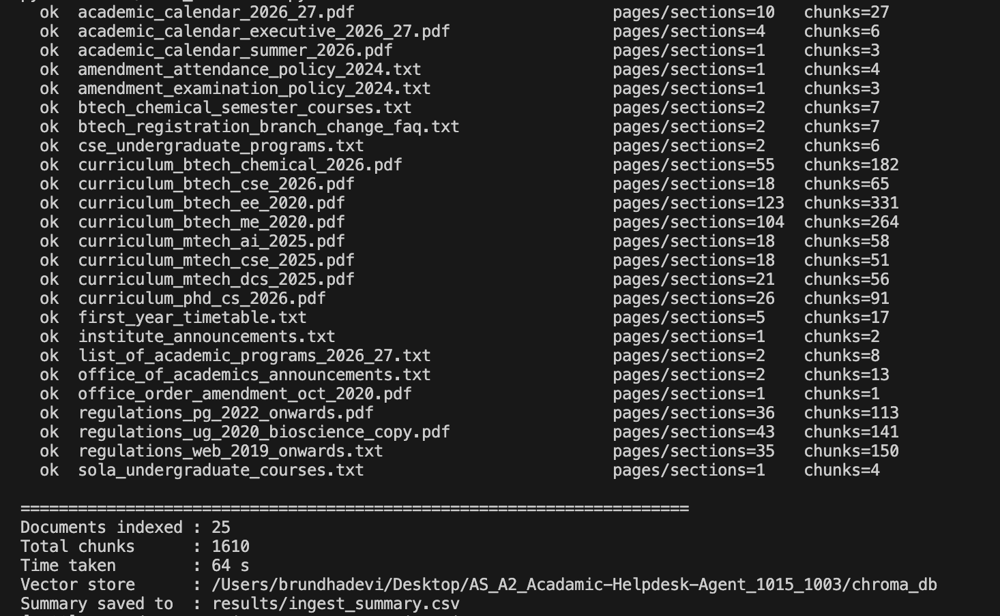
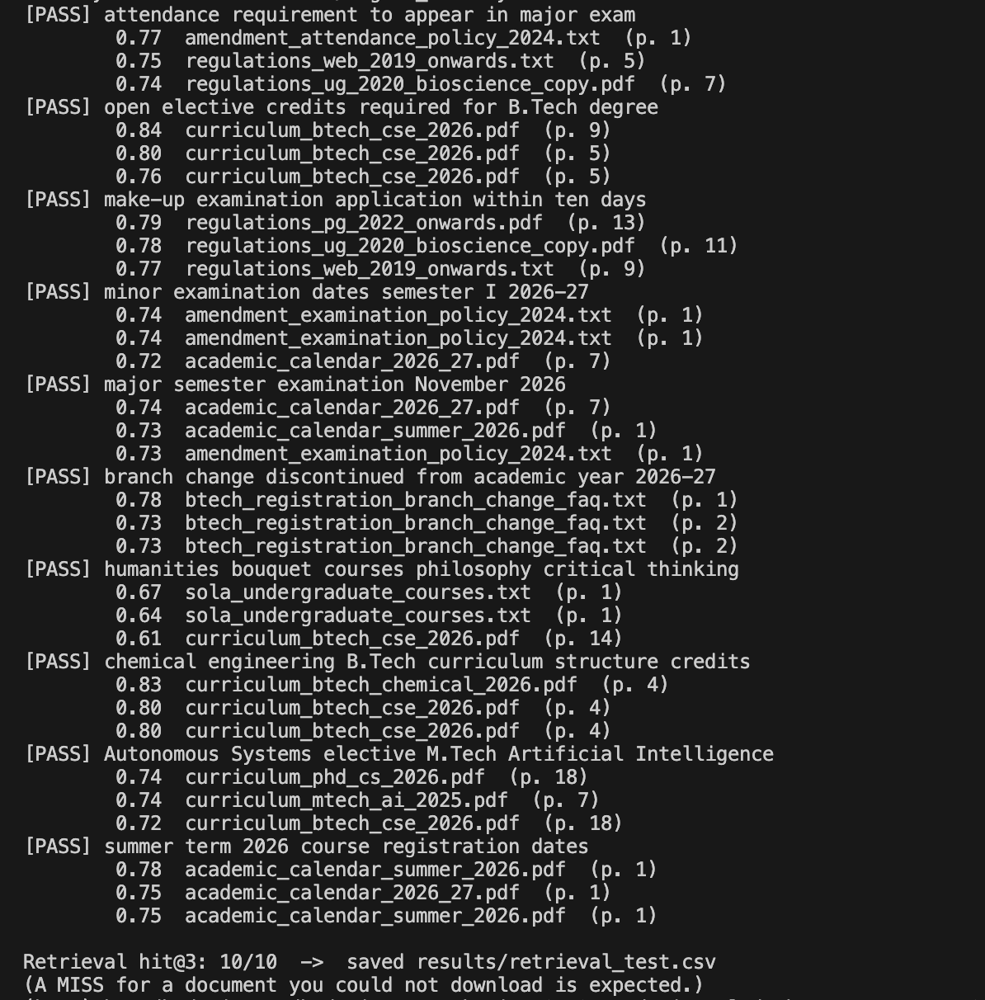
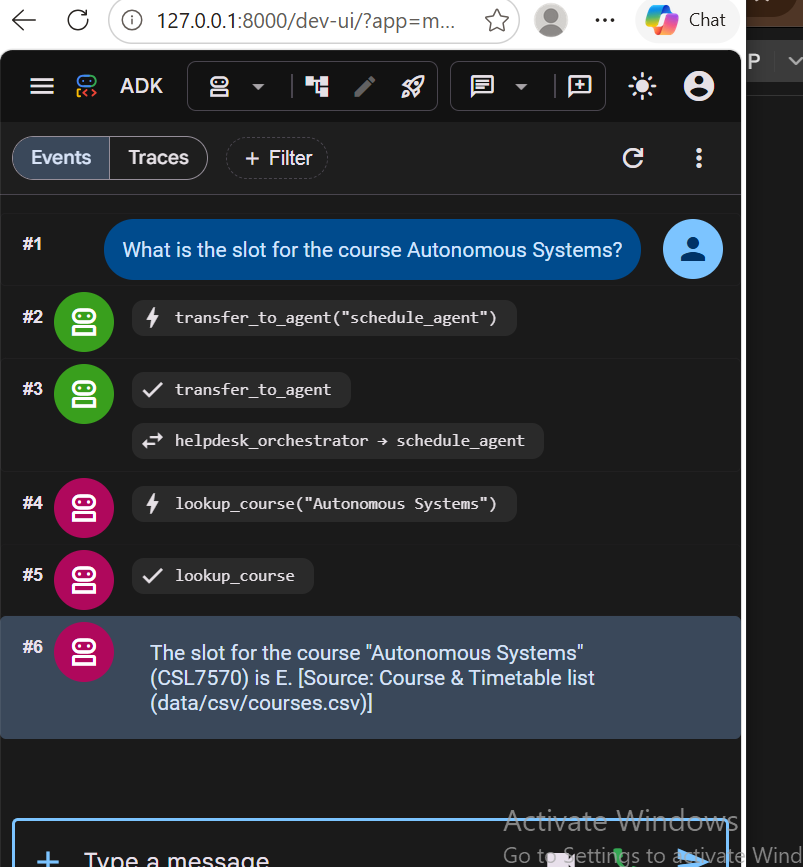
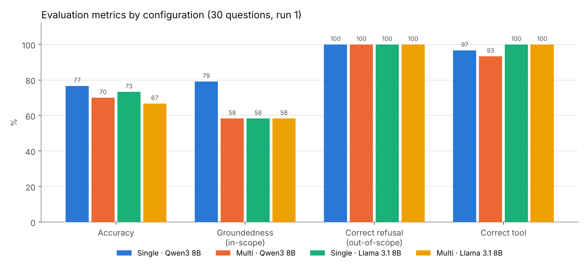
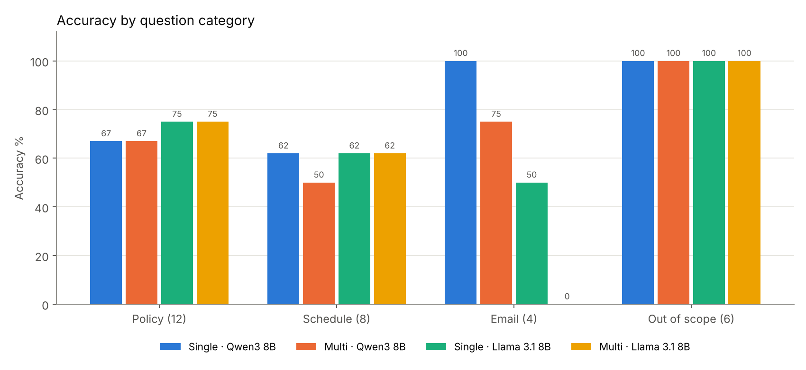

Indian Institute of Technology Jodhpur

**CSL7570 — Autonomous Systems** · Assignment 2

# Multi-Agent Academic Helpdesk Agent

*Retrieval-augmented generation with tools, citations and refusals using Google ADK, Ollama and ChromaDB*

**ANSHIKA ROLYA (B23CH1003)** · **BRUNDHA DEVI A (B23CH1015)**

30 October 2026

**[View PDF](Academic_Helpdesk_Agent_Report.pdf)** · **[Download Word (.docx)](https://github.com/brundhaiitj/AS_A2_Acadamic-Helpdesk-Agent_1015_1003/raw/main/report/Academic_Helpdesk_Agent_Report.docx)**

---

# 1. Introduction
This report presents a multi-agent Academic Helpdesk Agent for IIT
Jodhpur. The agent answers questions about academic programs, course
contents, academic rules and regulations, course slots, electives and
the academic calendar. It also drafts emails to course instructors to
apply for sick leave or to seek permission for a make-up examination.
Every answer cites the official document it came from. For any question
outside this scope, the agent says that it does not know instead of
guessing, and it logs the question so that a human can answer it.

The system runs fully offline on a laptop with 16 GB RAM. It uses Google
ADK as the agent framework, LiteLLM to connect ADK to models served by
Ollama (Qwen3 8B and Llama 3.1 8B), a local embedding model
(nomic-embed-text) and a local ChromaDB vector store.

**Summary of results.** On a set of 30 evaluation questions, all four
configurations refused 100 % of the out-of-scope questions and logged
every refusal. The configurations were single agent and multi-agent,
each with Qwen3 8B and with Llama 3.1 8B. The multi-agent system with
Qwen3 8B routed 100 % of the questions to the correct specialist agent
and answered 70.0 % of all questions correctly. The single agent with
Qwen3 8B reached the highest accuracy, 76.7 %. Most errors came from
retrieval: the wrong academic calendar was chosen for exam dates, and
old and new rules appeared in the same text chunk.

## 1.1 Example questions the helpdesk must handle
| **Type**     | **Example question**                                                                          | **Expected behaviour**                               |
|--------------|-----------------------------------------------------------------------------------------------|------------------------------------------------------|
| Rules        | What is the attendance requirement to sit in the Major exam?                                  | Answer from the regulations, with citation           |
| Time table   | What is the slot for the course Autonomous Systems?                                           | Look up the course list                              |
| Electives    | How many 400 level electives have been floated by the Humanities department in this semester? | Count electives for the current semester             |
| Curriculum   | How many Open Elective credits do I need to earn in order to get a B.Tech. degree?            | Answer from the curriculum, with citation            |
| Email        | Write an email to the course instructor of CSL7570 that I need leave for 2 days.              | Find the instructor, draft the email, do not send it |
| Out of scope | What are the available dining options on the campus?                                          | Say it does not know; log the question               |
| Out of scope | What is the best way to reach the campus from Jodhpur city center?                            | Say it does not know; log the question               |

# 2. System architecture
The helpdesk has two versions. The base version is a single agent that
holds all tools. The multi-agent version puts an orchestrator in front
of three specialist agents. Both versions share the same RAG pipeline,
tools, prompt rules and safety callbacks, so the comparison between them
isolates the effect of the agent structure.

| **Layer**            | **Choice**                                                                                            |
|----------------------|-------------------------------------------------------------------------------------------------------|
| Agent framework      | Google ADK (LlmAgent, sub_agents, transfer_to_agent, model and tool callbacks)                        |
| LLM connector        | LiteLLM (ollama_chat provider) inside ADK                                                             |
| Chat models (Ollama) | Qwen3 8B (thinking mode off) and Llama 3.1 8B; temperature 0, context 8,192 tokens                    |
| Embedding model      | nomic-embed-text (768-dimensional), served locally by Ollama                                          |
| Vector store         | ChromaDB, persistent, cosine similarity                                                               |
| Structured data      | courses.csv (course, slot, instructor, credits, semester), faculty.csv (instructor and office emails) |
| User interfaces      | ADK web UI (adk web src) and a terminal chat (python src/chat.py --agent single\|multi)               |
| Hardware             | Runs offline on a 16 GB RAM laptop; no GPU required                                                   |

*Figure 1. Multi-agent architecture: the orchestrator routes each
question to a specialist or refuses it; each specialist uses only its
own tools.*

# 3. Document collection
We collected 25 real documents from the official IIT Jodhpur websites
(iitj.ac.in and department sites). They cover all the source types the
assignment asks for:

- rules and regulations (UG/PG regulations of 2019, 2020 and 2022)

- recent office orders and circulars, including the two Senate-approved
  amendments of 08 July 2024 on attendance and examinations

- the AY 2026-27 academic calendars and the first-year time table

- course registration and branch-change information

- B.Tech, M.Tech and PhD curricula, the SoLA (Humanities) course list
  and the list of academic programs

Web pages were saved as clean text. The two scanned circulars had no
text layer, so they were transcribed into text files. Course slots,
instructors and faculty email IDs are kept as structured CSV files.
**Personal data was replaced with dummy values:** the email IDs of
current-semester instructors are dummies such as
csl7570.instructor@iitj.ac.in.

| **\#** | **Document**                                                                                | **Category** | **Year**            | **Chunks** |
|--------|---------------------------------------------------------------------------------------------|--------------|---------------------|------------|
| 1      | IIT Jodhpur Academic Regulations - UG and PG (web version incl. branch change update)       | rules        | 2019 (updated 2025) | 150        |
| 2      | Rules and Regulations for PG Programmes (enrolled from July 2022 onwards)                   | rules        | 2022                | 113        |
| 3      | Academic Regulations (students enrolled from July 2020 onwards)                             | rules        | 2020                | 141        |
| 4      | Notification: Amendments to Academic Regulations (26 Oct 2020)                              | office order | 2020                | 1          |
| 5      | Circular: Amendment in the Attendance Policy (08 July 2024; from Sem I AY 2024-25)          | office order | 2024                | 4          |
| 6      | Circular: Amendment in the Examination Policy - one Minor and one Major exam (08 July 2024) | office order | 2024                | 3          |
| 7      | B.Tech Registration and Academic Session FAQ (branch change discontinued from AY 2026-27)   | rules        | 2026                | 7          |
| 8      | Academic Calendar AY 2026-27                                                                | calendar     | 2026                | 27         |
| 9      | Academic Calendar Summer Term 2026                                                          | calendar     | 2026                | 3          |
| 10     | Academic Calendar for Executive Students AY 2026-27                                         | calendar     | 2026                | 6          |
| 11     | B.Tech Chemical Engineering Programme Course Curriculum (2026)                              | curriculum   | 2026                | 182        |
| 12     | B.Tech Chemical Engineering - semester-wise courses (Office of Academics)                   | curriculum   | 2025                | 7          |
| 13     | B.Tech Computer Science and Engineering UG Curriculum (2026 onwards)                        | curriculum   | 2026                | 65         |
| 14     | CSE Department - Undergraduate Programs (B.Tech CSE and AIDE)                               | curriculum   | 2026                | 6          |
| 15     | M.Tech Artificial Intelligence Detailed Curriculum (AY 2025 onwards)                        | curriculum   | 2025                | 58         |
| 16     | M.Tech CSE Detailed Curriculum (AY 2025 onwards)                                            | curriculum   | 2025                | 51         |
| 17     | PhD Computer Science Curriculum with Electives (July 2026)                                  | curriculum   | 2026                | 91         |
| 18     | M.Tech Data and Computational Sciences Curriculum (July 2025)                               | curriculum   | 2025                | 56         |
| 19     | B.Tech Electrical Engineering Curriculum Structure (2nd year onwards)                       | curriculum   | 2020                | 331        |
| 20     | B.Tech Mechanical Engineering Curriculum Structure (2nd year onwards)                       | curriculum   | 2020                | 264        |
| 21     | School of Liberal Arts (Humanities) - Undergraduate Courses                                 | curriculum   | 2025                | 4          |
| 22     | List of Academic Programs offered by IIT Jodhpur (AY 2026-27)                               | programs     | 2026                | 8          |
| 23     | UG First Year Class Time Table - instructors and classrooms (Office of Academics)           | timetable    | 2023                | 17         |
| 24     | Office of Academics - Announcements (Convocation 2026 etc.)                                 | notices      | 2026                | 13         |
| 25     | IIT Jodhpur - All Announcements                                                             | notices      | 2026                | 2          |

*Table 1. The 25 indexed documents (data/csv/sources.csv lists each
URL).*

# 4. RAG pipeline
The ingestion script (src/ingest.py) reads PDF and text files and splits
each page into overlapping chunks of 900 characters with an overlap of
150 characters. It embeds each chunk locally with nomic-embed-text,
using the search_document: and search_query: prefixes the model expects,
and stores the chunks in ChromaDB. The result is 1,610 chunks from 25
documents, built in about one minute.

Each chunk carries metadata: document title, file name, page, year,
category and URL. These fields are what the agent quotes in its citation
\[Source: \<document\>, p. \<page\>\].

At query time, search_documents embeds the question and retrieves the 10
nearest chunks. It then adds a small recency bonus (+0.004 per year
after 2019) so that a newer rule outranks a superseded one, and returns
the top 5 with their source, page, year and relevance score.

**Retrieval test.** On 10 test queries, one of the expected documents
was in the top 3 results for every query (hit@3 = 10/10).

*Figure 2. Ingestion output: 25 documents, 1,610 chunks.*

*Figure 3. Retrieval test: hit@3 = 10/10, with relevance score, document
and page for each hit.*

# 5. Tools
The agents use six Python function tools (src/tools.py). ADK turns each
function's signature and docstring into a tool definition for the LLM.

| **Tool**                                      | **Purpose**                                                                                                                                          | **Data source**                       |
|-----------------------------------------------|------------------------------------------------------------------------------------------------------------------------------------------------------|---------------------------------------|
| search_documents(query)                       | Returns the 5 most relevant chunks with document title, page, year and relevance                                                                     | ChromaDB                              |
| lookup_course(course)                         | Slot, instructor, credits and room of a course, by code or name                                                                                      | courses.csv                           |
| count_electives(department, level)            | Number and list of electives floated in the current semester (AY 2026-27 Sem I) by a department at a level                                           | courses.csv                           |
| get_instructor_email(course_code)             | Instructor name and email, and the department office email                                                                                           | courses.csv, faculty.csv              |
| draft_email(course_code, purpose, details, …) | Builds a sick-leave / leave / make-up exam email with the relevant rule, saves it to outputs/email_drafts/ for the student to review; never sends it | courses.csv, faculty.csv, regulations |
| log_unanswered(question, reason)              | Appends a question the agent cannot answer to logs/unanswered_log.csv for a human                                                                    | log file                              |

# 6. Base version: single agent
The single agent is one ADK LlmAgent that has all six tools and an
instruction with explicit rules:

1.  **Scope.** Answer only questions on academic programs, curriculum
    and credits, rules and regulations, calendar dates, slots and
    electives, and instructor emails.

2.  **Grounding.** Never answer from the model's own memory; every fact
    must come from a tool result.

3.  **Tool choice.** Rules go to search_documents, a course to
    lookup_course, an elective count to count_electives, an email ID to
    get_instructor_email, and an email to draft_email.

4.  **Citation.** End every answer with \[Source: \<document\>, p.
    \<page\>\], and never cite a tool name as a source.

5.  **Refusal.** If the question is out of scope or the documents do not
    contain the answer, call log_unanswered and reply with a fixed
    message: "I'm sorry, I don't know the answer to that… I have logged
    your question for the helpdesk staff to answer."

6.  **Versions.** If documents of different years disagree, follow the
    newest one and name it.

**Safety callbacks.** Small local models do not always follow the
prompt. A model callback shared by all agents (src/guardrails.py) does
three things:

- removes any reasoning ("thinking") text, so the user sees only the
  final answer

- if a refusal was given without calling log_unanswered, logs the
  question automatically

- replaces any refusal with the standard text, which removes invented
  citations such as \[Source: log_unanswered\]

# 7. Multi-agent version
The multi-agent version (src/multi_agent) follows the design suggested
in the assignment: a helpdesk orchestrator transfers each question to a
policy agent, a schedule agent or an email agent.

| **Agent**             | **Handles**                                                                                                                                  | **Tools**                                                        |
|-----------------------|----------------------------------------------------------------------------------------------------------------------------------------------|------------------------------------------------------------------|
| helpdesk_orchestrator | Reads the question and transfers it with transfer_to_agent; refuses and logs out-of-scope questions itself; never answers academic questions | log_unanswered                                                   |
| policy_agent          | Rules and regulations, attendance, exams, grading, leave, credits, curriculum                                                                | search_documents, log_unanswered                                 |
| schedule_agent        | Course slots, time table, instructors of a course, electives this semester, calendar dates                                                   | lookup_course, count_electives, search_documents, log_unanswered |
| email_agent           | Instructor email IDs; leave and make-up exam email drafts                                                                                    | get_instructor_email, draft_email, log_unanswered                |

- **Routing.** The orchestrator chooses a specialist from the
  specialists' descriptions and calls ADK's built-in transfer_to_agent.

- **No ping-pong.** The specialists have disallow_transfer_to_parent and
  disallow_transfer_to_peers set, so the agent that receives a question
  must answer it.

- **Smaller tool sets.** Each specialist sees only its own tools and a
  shorter instruction, which leaves fewer ways to pick a wrong tool.

- **Early refusal.** Out-of-scope questions are refused at the front
  desk, before any retrieval or tool call.

*Figure 4. ADK web UI: the orchestrator transfers the question to
schedule_agent, which calls lookup_course and answers "Slot E" with its
source.*

# 8. Answers to the assignment's example questions
The table shows the actual answers of the multi-agent system (Qwen3 8B)
to the example questions from the assignment, taken from the evaluation
run. The route column shows the specialist agent and tool that ADK
recorded.

<table>
<colgroup>
<col style="width: 22%" />
<col style="width: 51%" />
<col style="width: 17%" />
<col style="width: 8%" />
</colgroup>
<thead>
<tr class="header">
<th><strong>Question</strong></th>
<th><strong>Answer (multi-agent, Qwen3 8B)</strong></th>
<th><strong>Route / tool</strong></th>
<th><strong>Result</strong></th>
</tr>
</thead>
<tbody>
<tr class="odd">
<td>Attendance requirement to sit in the Major exam</td>
<td>The attendance requirement to sit in the Major exam is that a
student's attendance should not fall below 75% in a course. If a
student's attendance is below 75%, they will still be allowed to appear
for the exams, but they must score at least a C grade to pas…</td>
<td>
policy_agent

search_documents
</td>
<td>Partly wrong</td>
</tr>
<tr class="even">
<td>Slot of Autonomous Systems</td>
<td>The slot for the course "Autonomous Systems" (CSL7570) is E.
[Source: Course &amp; Timetable list (data/csv/courses.csv)]</td>
<td>
schedule_agent

lookup_course
</td>
<td>Correct</td>
</tr>
<tr class="odd">
<td>400-level electives floated by Humanities this semester</td>
<td>There are 6 electives at the 400 level floated by the Humanities
department in this semester. The courses are: Introduction to
Philosophy, Fundamentals of Logic, Critical Thinking, Theories of
Justice, Gandhian Thought, and Role of Technology in Development. …</td>
<td>
schedule_agent

count_electives
</td>
<td>Correct</td>
</tr>
<tr class="even">
<td>Open Elective credits for a B.Tech degree</td>
<td>Students in the regular B.Tech programme are required to complete 12
credits of open elective courses. [Source: B.Tech Computer Science and
Engineering UG Curriculum (2026 onwards), p. 9]</td>
<td>
policy_agent

search_documents
</td>
<td>Correct</td>
</tr>
<tr class="odd">
<td>Leave email to the CSL7570 instructor (2 days)</td>
<td>Full draft addressed to csl7570.instructor@iitj.ac.in, subject
"Request for leave of absence - CSL7570", marked "This is a draft and
has NOT been sent." (see Figure 5)</td>
<td>
email_agent

draft_email
</td>
<td>Correct</td>
</tr>
<tr class="even">
<td>Dining options on the campus</td>
<td>I'm sorry, I don't know the answer to that. It is outside what I can
help with, so I have logged your question for the helpdesk staff to
answer.</td>
<td>
orchestrator

–
</td>
<td>Correct</td>
</tr>
<tr class="odd">
<td>Best way to reach the campus from Jodhpur city</td>
<td>I'm sorry, I don't know the answer to that. It is outside what I can
help with, so I have logged your question for the helpdesk staff to
answer.</td>
<td>
orchestrator

log_unanswered
</td>
<td>Correct</td>
</tr>
</tbody>
</table>

*Table 2. Example questions from the assignment and the system's
answers.*

Six of the seven examples are answered correctly with a correct citation
or tool result. The attendance question cites the right document, the 08
July 2024 circular. It correctly says that attendance should not fall
below 75 % and that a student is still allowed to appear for the exams.
However, it also repeats the C-grade condition, which belongs to the
superseded policy quoted inside the same circular. The cause is analysed
in Section 11.

**Email draft (Q21).** The email agent returns the full draft for the
student to review; the email is saved in outputs/email_drafts/ and is
never sent:

<table>
<colgroup>
<col style="width: 100%" />
</colgroup>
<tbody>
<tr class="odd">
<td>
This is a draft and has NOT been sent.

To: csl7570.instructor@iitj.ac.in

Subject: Request for leave of absence - CSL7570

Body:

Dear Sir/Madam,

I am writing to inform you that I will be unable to attend the
classes of CSL7570 - Autonomous Systems and to request leave for the
following: 2 days.

I will submit the supporting document (e.g. medical certificate) as
required, and I will make sure to cover the missed lectures and any
assignments.

Thank you for your consideration.

Yours sincerely,

Student Name

Roll No.: Roll Number

IIT Jodhpur
</td>
</tr>
</tbody>
</table>

*Figure 5. Email draft produced for Q21 (instructor email is a dummy
value).*

**Log of unanswered questions.** Every refused question is written to
logs/unanswered_log.csv with a status for the helpdesk staff:

| **Time (UTC)**      | **Question**                                                       | **Reason**                     | **Status**           |
|---------------------|--------------------------------------------------------------------|--------------------------------|----------------------|
| 2026-10-29 18:50:25 | What are the available dining options on the campus?               | refused by agent (auto-logged) | pending human answer |
| 2026-10-29 20:37:04 | What is the best way to reach the campus from Jodhpur city center? | out of scope                   | pending human answer |
| 2026-10-29 20:26:43 | What will the weather be like in Jodhpur tomorrow?                 | out of scope                   | pending human answer |
| 2026-10-29 20:27:29 | How do I apply for a hostel room change?                           | refused by agent (auto-logged) | pending human answer |
| 2026-10-29 20:27:48 | Who won the last IPL final?                                        | out of scope                   | pending human answer |
| 2026-10-29 20:28:34 | Can you write a Python program to sort a list?                     | refused by agent (auto-logged) | pending human answer |

*Table 3. Excerpt of the unanswered-question log (out-of-scope
questions).*

# 9. Evaluation method
**Question set.** eval/questions.csv contains 30 prompts:

- 12 policy questions

- 8 schedule questions

- 4 email questions

- 6 out-of-scope questions

The set includes all seven examples from the assignment. Each question
has an expected answer, an expected source document and an expected
tool. eval/answer_keys.csv lists, for each question, the key facts the
answer must contain and the specialist agent that should handle it. The
full list is in Appendix A.

**Metrics** (eval/score.py):

| **Metric**             | **Definition**                                                                                                                                                                                               |
|------------------------|--------------------------------------------------------------------------------------------------------------------------------------------------------------------------------------------------------------|
| Accuracy               | The answer contains all key facts and is not a wrong refusal; for out-of-scope questions, the answer is a refusal. Every answer was also checked by hand and the automatic score was corrected where needed. |
| Groundedness           | For in-scope questions: the \[Source: …\] cites one of the expected documents.                                                                                                                               |
| Citation present       | For in-scope questions: the answer contains a \[Source: …\] citation at all.                                                                                                                                 |
| Correct refusal        | Share of out-of-scope questions that were refused. False refusal: share of in-scope questions that were wrongly refused.                                                                                     |
| Refusals logged        | Share of out-of-scope questions that appear in logs/unanswered_log.csv.                                                                                                                                      |
| Correct tool / routing | The expected tool was called; for the multi-agent system, the question reached the expected specialist (or stayed with the orchestrator if out of scope).                                                    |
| Consistency            | The same question was asked again in a second run; we record whether the answer text or its correctness changed.                                                                                             |

**Configurations.** We evaluated four configurations: the single agent
and the multi-agent system, each with Qwen3 8B and with Llama 3.1 8B. In
run 1, all 30 questions were asked in all four configurations. In run 2,
10 questions were asked again in both Qwen3 configurations to measure
consistency. In total, 140 answers were scored. All runs used Ollama on
CPU, temperature 0, and a fresh session for every question. The scripts
are eval/run_eval.py (asks the questions), eval/score.py (scores them)
and eval/final_tables.py (tables and charts).

# 10. Results
## 10.1 Overall metrics
| **Configuration**     | **Accuracy** | **In-scope accuracy** | **Grounded** | **Citation present** | **Correct refusal** | **False refusal** | **Refusals logged** | **Correct tool** | **Correct routing** | **Median time** |
|-----------------------|--------------|-----------------------|--------------|----------------------|---------------------|-------------------|---------------------|------------------|---------------------|-----------------|
| Single · Qwen3 8B     | 76.7 %       | 70.8 %                | 79.2 %       | 95.8 %               | 100.0 %             | 4.2 %             | 100.0 %             | 96.7 %           | –                   | 250 s           |
| Multi · Qwen3 8B      | 70.0 %       | 62.5 %                | 58.3 %       | 79.2 %               | 100.0 %             | 16.7 %            | 100.0 %             | 93.3 %           | 100.0 %             | 171 s           |
| Single · Llama 3.1 8B | 73.3 %       | 66.7 %                | 58.3 %       | 83.3 %               | 100.0 %             | 4.2 %             | 100.0 %             | 100.0 %          | –                   | 262 s           |
| Multi · Llama 3.1 8B  | 66.7 %       | 58.3 %                | 58.3 %       | 87.5 %               | 100.0 %             | 4.2 %             | 100.0 %             | 100.0 %          | 93.3 %              | 306 s           |

*Table 4. Evaluation metrics on 30 questions (run 1). Groundedness,
citation and false refusal refer to the 24 in-scope questions; correct
refusal and logging to the 6 out-of-scope questions.*

*Figure 6. Accuracy, groundedness, correct refusal and correct tool use
by configuration.*

## 10.2 Accuracy by question category
| **Category**     | **Single · Qwen3 8B** | **Multi · Qwen3 8B** | **Single · Llama 3.1 8B** | **Multi · Llama 3.1 8B** |
|------------------|-----------------------|----------------------|---------------------------|--------------------------|
| Policy (12)      | 67 %                  | 67 %                 | 75 %                      | 75 %                     |
| Schedule (8)     | 62 %                  | 50 %                 | 62 %                      | 62 %                     |
| Email (4)        | 100 %                 | 75 %                 | 50 %                      | 0 %                      |
| Out of scope (6) | 100 %                 | 100 %                | 100 %                     | 100 %                    |

*Table 5. Accuracy (%) per question category (run 1).*

*Figure 7. Accuracy per question category and configuration.*

## 10.3 Single agent vs multi-agent
| **Aspect**                                | **Single agent** | **Multi-agent** | **Observation**                                                          |
|-------------------------------------------|------------------|-----------------|--------------------------------------------------------------------------|
| Accuracy (Qwen3 / Llama 3.1)              | 76.7 % / 73.3 %  | 70.0 % / 66.7 % | Multi-agent about 7 points lower with both LLMs                          |
| Correct refusal of out-of-scope questions | 100 % / 100 %    | 100 % / 100 %   | Equal; multi-agent refuses at the orchestrator without any tool call     |
| False refusals (in-scope)                 | 4.2 % / 4.2 %    | 16.7 % / 4.2 %  | Qwen3 specialists gave up on 4 answerable questions (Q06, Q10, Q19, Q23) |
| Correct routing                           | –                | 100 % / 93.3 %  | Qwen3 sent all 30 questions to the right agent; Llama 3.1 misrouted 2    |
| Correct tool                              | 96.7 % / 100 %   | 93.3 % / 100 %  | Specialists picked the right tool almost always                          |
| Email category                            | 100 % / 50 %     | 75 % / 0 %      | Llama 3.1 email agent dropped the draft text from its reply              |
| Median time per answer                    | 250 s / 262 s    | 171 s / 306 s   | Multi-agent needs one extra LLM call (the transfer)                      |

*Table 6. Single agent vs multi-agent (values: Qwen3 8B / Llama 3.1
8B).*

The multi-agent design gives a clear structure: correct routing, small
tool sets per agent and early refusals. On this question set, however,
it did not improve accuracy. The orchestrator adds one more LLM
decision, and a specialist with a narrow instruction refuses more
readily when its first search returns weak evidence. The single agent
can recover by calling a second tool, which the specialists cannot do
outside their own tool set.

## 10.4 Changing the LLM: Qwen3 8B vs Llama 3.1 8B
| **Aspect**                        | **Qwen3 8B**                                                 | **Llama 3.1 8B**                                                                               |
|-----------------------------------|--------------------------------------------------------------|------------------------------------------------------------------------------------------------|
| Accuracy (single / multi)         | 76.7 % / 70.0 %                                              | 73.3 % / 66.7 %                                                                                |
| Groundedness, single agent        | 79.2 %                                                       | 58.3 %                                                                                         |
| Policy questions (single / multi) | 67 % / 67 %                                                  | 75 % / 75 %                                                                                    |
| Email questions (single / multi)  | 100 % / 75 %                                                 | 50 % / 0 %                                                                                     |
| Routing (multi-agent)             | 100 %                                                        | 93.3 %                                                                                         |
| Out-of-scope refusals             | 100 %                                                        | 100 %                                                                                          |
| Typical failure                   | Refuses an answerable question; repeats superseded rule text | Drops the email draft text; copies an email ID with a typo; cites file names instead of titles |

*Table 7. Effect of replacing the LLM.*

Qwen3 8B was the better model overall: it was more accurate in both
architectures and grounded its single-agent answers much better. Llama
3.1 8B was slightly stronger on policy questions. For example, it
answered the branch-change question (Q10) correctly where both Qwen3
configurations refused. Llama 3.1 was clearly weaker at the email tasks.
In the multi-agent system it called draft_email correctly, but replied
only with "This is a draft and has NOT been sent." and left out the
draft text. It also returned "rjlaxmichouhan@iitj.ac.in" instead of
"rajlaxmichouhan@iitj.ac.in".

## 10.5 Questions whose answers changed between runs
At temperature 0, 15 of the 20 repeated question–configuration pairs
produced the same answer. The wording changed in 5 pairs, and the
correctness changed in 2:

| **Configuration** | **Question**                                                                                                                              | **Run 1** | **Run 2** | **Change**                                          |
|-------------------|-------------------------------------------------------------------------------------------------------------------------------------------|-----------|-----------|-----------------------------------------------------|
| Multi · Qwen3 8B  | Q06: How many days of short leave can a UG student take on medical grounds?                                                               | Wrong     | Correct   | Refusal in run 1, correct answer (10 days) in run 2 |
| Multi · Qwen3 8B  | Q08: How many credits must a general category B.Tech student earn by the end of the second semester to continue in the program?           | Wrong     | Wrong     | Wrong in both runs; wording changed                 |
| Multi · Qwen3 8B  | Q22: Draft an email to the instructor of MAL1010 asking for permission to take the make-up exam for the Minor because I was hospitalised. | Correct   | Correct   | Correct in both runs; email wording changed         |
| Single · Qwen3 8B | Q07: How many grade points is an A- grade worth?                                                                                          | Correct   | Wrong     | Correct answer (9) in run 1, refusal in run 2       |
| Single · Qwen3 8B | Q22: Draft an email to the instructor of MAL1010 asking for permission to take the make-up exam for the Minor because I was hospitalised. | Correct   | Correct   | Correct in both runs; email wording changed         |

*Table 8. Answers that changed between run 1 and run 2 (Qwen3 8B).*

The questions with identical answers in both runs were Q07
(multi-agent), Q06 (single), Q08 (single), Q13, Q14, Q18, Q21, Q25 and
Q26. Both correctness changes were flips between answering and refusing.
A small difference in the retrieved chunks or in the model's first
decision decides whether the agent trusts the evidence. Factual answers
that were given were stable, and refusals of out-of-scope questions were
identical in every run.

# 11. Error analysis
Five questions failed in all four configurations (Q01, Q08, Q14, Q15 and
Q16), so most of the lost accuracy comes from retrieval and the document
text, not from the LLM or the agent structure.

| **Questions**                                       | **What happened**                                                            | **Cause**                                                                                                 | **Possible fix**                                                                       |
|-----------------------------------------------------|------------------------------------------------------------------------------|-----------------------------------------------------------------------------------------------------------|----------------------------------------------------------------------------------------|
| Q14, Q15: Minor and Major exam dates, Sem I 2026-27 | Answered with Summer Term 2026 dates (May–June 2026)                         | The summer-term calendar is the newest file, so the recency bonus ranked it above the AY 2026-27 calendar | Filter by semester in the metadata; apply the recency bonus only across academic years |
| Q16: Sem II classes begin                           | 1 or 15 January 2027 instead of 4 January 2027                               | The calendar table was split across chunks and the row was misread                                        | Ingest calendar tables as structured rows                                              |
| Q01: attendance for the Major exam                  | Qwen3 added the superseded C-grade rule; Llama 3.1 stated only the 75 % rule | The circular quotes the old rule just before the revised one, in the same chunk                           | Index only the revised policy, or tag old paragraphs as superseded                     |
| Q08: credits by end of the 2nd semester             | 75, 80 or 153 credits; correct answer is 18                                  | PG regulations and curricula have similar wording; the UG table was not retrieved                         | Add a UG/PG filter to search_documents                                                 |
| Q06, Q10, Q19, Q23 (multi · Qwen3)                  | Specialist refused an answerable question                                    | Narrow instruction plus a weak first search                                                               | Allow one reformulated search before refusing                                          |
| Q21, Q22, Q24 (Llama 3.1)                           | Missing draft text; email ID typo                                            | The model rewrites tool output in its final reply                                                         | Return drafts and email IDs verbatim from the tool                                     |

*Table 9. Main failure cases and their causes.*

**What worked reliably.** Out-of-scope questions were refused and logged
in all 24 cases (6 questions × 4 configurations). This comes from the
explicit scope list in the instructions and the callback that logs any
refusal the model forgets to log. Simple lookups were correct in every
configuration, with a citation in most cases: the course slot, the
elective count, the Open Elective credits, the make-up exam rule and the
semester break. The recency rerank correctly preferred the 2026
curriculum (12 Open Elective credits) over the 2019 regulations (10
credits).

# 12. Conclusion
We built a local multi-agent academic helpdesk that answers from 25
official IIT Jodhpur documents and structured course data. It cites its
sources, drafts instructor emails without sending them, refuses
out-of-scope questions and logs them for a human.

On 30 evaluation questions, every configuration refused 100 % of the
out-of-scope questions. The multi-agent system routed 100 % (Qwen3) and
93.3 % (Llama 3.1) of the questions to the correct specialist. The best
accuracy, 76.7 %, came from the single agent with Qwen3 8B. The
multi-agent system reached 70.0 % with the same model.

Qwen3 8B outperformed Llama 3.1 8B overall, especially on grounding and
email drafting. Llama 3.1 was slightly better on policy questions.
Answers were mostly stable across runs; the two changes were both flips
between answering and refusing.

The largest remaining errors come from retrieval: choosing the right
calendar, separating UG from PG rules, and superseded text inside new
circulars. Metadata filters and cleaner document preparation would
address these directly.

# 13. Code repository and how to run
Repository:
[https://github.com/brundhaiitj/AS_A2_Acadamic-Helpdesk-Agent_1015_1003](https://github.com/brundhaiitj/AS_A2_Acadamic-Helpdesk-Agent_1015_1003)

| **Path**                                                | **Content**                                                                   |
|---------------------------------------------------------|-------------------------------------------------------------------------------|
| README.md                                               | Setup, how to run both agents, the tools, the evaluation commands             |
| data/docs/, data/csv/                                   | The 25 documents; sources.csv (titles, years, URLs), courses.csv, faculty.csv |
| src/ingest.py, src/embeddings.py                        | Chunking, local embeddings, ChromaDB index                                    |
| src/tools.py                                            | The six tools                                                                 |
| src/prompts.py, src/guardrails.py                       | Agent instructions and the safety callbacks                                   |
| src/single_agent/, src/multi_agent/                     | Base single agent; orchestrator with policy, schedule and email agents        |
| src/chat.py, src/runner.py                              | Terminal chat and programmatic runner                                         |
| eval/questions.csv, eval/answer_keys.csv                | The 30 evaluation questions and their answer keys                             |
| eval/run_eval.py, score.py, analyze.py, final_tables.py | Run the questions, score them, and build tables and charts                    |
| results/                                                | Raw answers, scores, consistency table and charts                             |
| logs/unanswered_log.csv, outputs/email_drafts/          | Log of unanswered questions; generated email drafts                           |

**Run:**

1.  pip install -r requirements.txt

2.  ollama pull qwen3:8b; ollama pull llama3.1:8b; ollama pull
    nomic-embed-text

3.  python src/ingest.py

4.  adk web src (choose single_agent or multi_agent), or python
    src/chat.py --agent multi

5.  python eval/run_eval.py --agent multi --model qwen3:8b; python
    eval/score.py; python eval/final_tables.py

# Appendix A. Evaluation questions and results per question
1 = correct, 0 = wrong (run 1, after manual review). Expected answers
and sources are in eval/questions.csv; all answers are in
results/scored_all.csv.

| **ID** | **Category** | **Question**                                                                                                                         | **Single Qwen3** | **Multi Qwen3** | **Single Llama** | **Multi Llama** |
|--------|--------------|--------------------------------------------------------------------------------------------------------------------------------------|------------------|-----------------|------------------|-----------------|
| Q01    | Policy       | What is the attendance requirement to sit in the Major exam?                                                                         | 0                | 0               | 0                | 0               |
| Q02    | Policy       | How many Open Elective credits do I need to earn in order to get a B.Tech. degree?                                                   | 1                | 1               | 1                | 1               |
| Q03    | Policy       | What are the minimum and maximum credits a UG student can register for in a semester?                                                | 1                | 1               | 1                | 1               |
| Q04    | Policy       | What is the maximum duration allowed to complete the B.Tech. program?                                                                | 1                | 1               | 1                | 1               |
| Q05    | Policy       | Within how many days must I apply for a make-up examination and to whom?                                                             | 1                | 1               | 1                | 1               |
| Q06    | Policy       | How many days of short leave can a UG student take on medical grounds?                                                               | 1                | 0               | 1                | 1               |
| Q07    | Policy       | How many grade points is an A- grade worth?                                                                                          | 1                | 1               | 1                | 1               |
| Q08    | Policy       | How many credits must a general category B.Tech student earn by the end of the second semester to continue in the program?           | 0                | 0               | 0                | 0               |
| Q09    | Policy       | What is the maximum number of credits I can register for in the summer term?                                                         | 0                | 1               | 0                | 0               |
| Q10    | Policy       | Is branch change allowed for B.Tech students admitted in 2026?                                                                       | 0                | 0               | 1                | 1               |
| Q11    | Policy       | What happens if a student is absent for four or more weeks in a semester?                                                            | 1                | 1               | 1                | 1               |
| Q12    | Policy       | How many total credits are required for the B.Tech. in Chemical Engineering under the latest curriculum?                             | 1                | 1               | 1                | 1               |
| Q13    | Schedule     | What is the slot for the course Autonomous Systems?                                                                                  | 1                | 1               | 1                | 1               |
| Q14    | Schedule     | When are the Minor examinations in Semester I of 2026-27?                                                                            | 0                | 0               | 0                | 0               |
| Q15    | Schedule     | When are the Major examinations for Semester I 2026-27?                                                                              | 0                | 0               | 0                | 0               |
| Q16    | Schedule     | When do classes begin for Semester II of 2026-27?                                                                                    | 0                | 0               | 0                | 0               |
| Q17    | Schedule     | What is the last date to request course withdrawal in Semester I 2026-27?                                                            | 1                | 1               | 1                | 1               |
| Q18    | Schedule     | How many 400 level electives have been floated by the Humanities department in this semester?                                        | 1                | 1               | 1                | 1               |
| Q19    | Schedule     | Who teaches Mathematics I (MAL1010) and what is its slot?                                                                            | 1                | 0               | 1                | 1               |
| Q20    | Schedule     | When is the semester break in Semester I 2026-27?                                                                                    | 1                | 1               | 1                | 1               |
| Q21    | Email        | Write an email to the course instructor of CSL7570 that I need leave for 2 days.                                                     | 1                | 1               | 1                | 0               |
| Q22    | Email        | Draft an email to the instructor of MAL1010 asking for permission to take the make-up exam for the Minor because I was hospitalised. | 1                | 1               | 1                | 0               |
| Q23    | Email        | Write a sick leave email to the Chemometrics instructor for 3 days because of fever.                                                 | 1                | 0               | 0                | 0               |
| Q24    | Email        | What is the email ID of the instructor of EEL1010?                                                                                   | 1                | 1               | 0                | 0               |
| Q25    | Out of scope | What are the available dining options on the campus?                                                                                 | 1                | 1               | 1                | 1               |
| Q26    | Out of scope | What is the best way to reach the campus from Jodhpur city center?                                                                   | 1                | 1               | 1                | 1               |
| Q27    | Out of scope | What will the weather be like in Jodhpur tomorrow?                                                                                   | 1                | 1               | 1                | 1               |
| Q28    | Out of scope | How do I apply for a hostel room change?                                                                                             | 1                | 1               | 1                | 1               |
| Q29    | Out of scope | Who won the last IPL final?                                                                                                          | 1                | 1               | 1                | 1               |
| Q30    | Out of scope | Can you write a Python program to sort a list?                                                                                       | 1                | 1               | 1                | 1               |
|        |              | **Total correct (of 30)**                                                                                                            | **23**           | **21**          | **22**           | **20**          |
