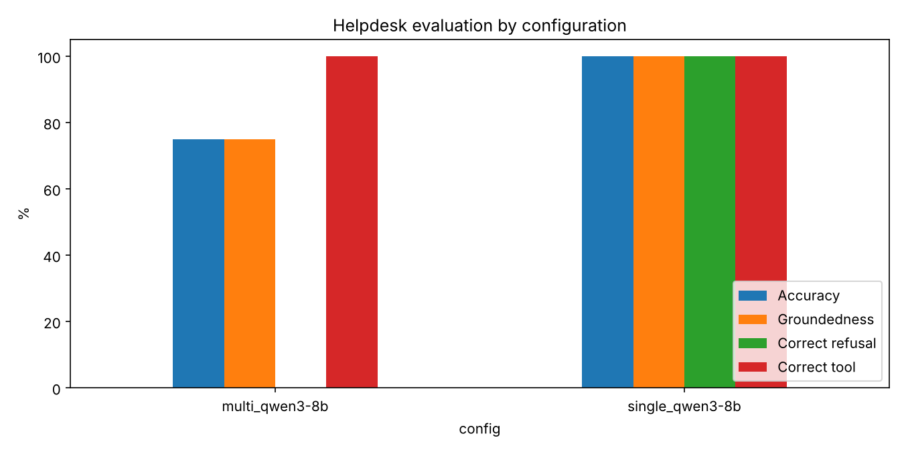

# IIT Jodhpur Academic Helpdesk Agent — Report

Autonomous Systems, Assignment 2 · Team: Roll 1015 (Person 1, Part 1) and Roll B23CH1003 (Person 2, Part 2)

## 1. Goal
A local academic helpdesk for IIT Jodhpur students. It answers questions on academic programmes, course contents,
rules and regulations, the time table and the academic calendar. It drafts emails to course instructors
(sick leave, leave of absence, make-up exam). It refuses out-of-scope questions and logs them for a human.
Every answer must cite the official document it came from.

**Stack (runs on a 16 GB laptop, offline after setup):** Google ADK 2.x agents → LiteLLM → Ollama
(`qwen3:8b`, `llama3.1:8b`), local embeddings `nomic-embed-text`, ChromaDB vector store.

## 2. Part 1 — Documents, RAG, tools and single agent (Person 1)

**Document collection.** 25 official documents were collected from IIT Jodhpur websites (iitj.ac.in and
department sub-sites). They are: UG/PG academic regulations; two policy circulars dated 08 July 2024 on attendance and
examinations (transcribed to text because the PDFs were scanned); an office order; the AY 2026-27 academic
calendars (regular, executive, summer); B.Tech, M.Tech and PhD curricula (Chemical, CSE, EE, ME, AI, DCS); the SoLA
course list; the list of programmes 2026-27; the first-year time table; and announcement pages. Structured data
(course code, slot, instructor, credits, semester) is kept in `data/csv/courses.csv` and `faculty.csv`. The
Autonomous Systems slot (E) was verified on ERP. **Privacy:** instructor email IDs for current courses are
dummy values, and no student data is stored.

**RAG pipeline.** Each document is split page-wise into overlapping chunks (900 characters, 150 overlap) and
embedded locally with `nomic-embed-text` (with `search_document:` / `search_query:` prefixes). The result is
1,610 chunks in a persistent ChromaDB collection (cosine). Each chunk stores metadata: title, file, page, year,
category and URL. The agent cites from this metadata. `search_documents` fetches 10 candidates and adds a small
recency bonus (+0.004 per year after 2019). It returns the top 5, so newer rules rank above superseded ones.
**Retrieval test:** hit@3 = 10/10 (`results/retrieval_test.csv`).

**Tools** (`src/tools.py`):

| Tool | Purpose |
|---|---|
| `search_documents(query)` | semantic search, returns passages + source + page + year |
| `lookup_course(course)` | slot, instructor, credits, room from the course CSV |
| `count_electives(department, level)` | electives floated this semester by a department at a level |
| `get_instructor_email(course_code)` | instructor + department office email |
| `draft_email(...)` | leave / make-up exam draft with the relevant rule, saved to `outputs/email_drafts/`, never sent |
| `log_unanswered(question, reason)` | appends to `logs/unanswered_log.csv` for a human |

**Single agent (base version).** This is one ADK `LlmAgent` with all six tools, using temperature 0, an 8k context and
Qwen3 "thinking" off. Its instruction restricts it to academic topics and forbids answering from memory. It requires a
`[Source: <document>, p. <page>]` citation, tells it to follow the newest document when versions disagree, and
makes it call `log_unanswered` and give a fixed refusal for out-of-scope questions.

**Guardrails** (`src/guardrails.py`, shared by all agents). The small models sometimes (a) printed their
reasoning text, (b) refused without calling `log_unanswered`, and (c) invented a citation
`[Source: log_unanswered]`. An `after_model_callback` removes the thinking text. If the final answer is a refusal
that was not logged, it logs the question automatically and replaces the reply with the standard refusal (no
fake source).

**Smoke test by Person 1 (qwen3:4b, 8 GB laptop):** 6/8 in-scope correct and 2/2 refusals. These failures were
found and fixed:
- Q4: the slot was "J" because of an unverified course row. It was corrected to E after the ERP check.
- Q5: the agent said the Minor exam dates were "not specified". This was fixed with a calendar hint in the prompt and the recency rerank.
- The refusals cited `log_unanswered` as a source and were not logged. This was fixed by the guardrail.

## 3. Part 2 — Multi-agent system (Person 2)

```
helpdesk_orchestrator  (routes; refuses + logs out-of-scope questions)
   ├── policy_agent    rules, regulations, attendance, exams, credits, curriculum   [search_documents]
   ├── schedule_agent  slots, time table, electives, calendar dates   [lookup_course, count_electives, search_documents]
   └── email_agent     instructor email IDs, email drafts             [get_instructor_email, draft_email]
```
- The orchestrator does not answer academic questions itself. It hands over with ADK's `transfer_to_agent`,
  based on each specialist's `description`. Out-of-scope questions are refused at the front desk.
- The specialists have `disallow_transfer_to_parent/peers=True`. Once a question is routed, that agent must answer
  it, which avoids ping-pong between agents. Each specialist gets only the tools it needs, so wrong tool calls
  are less likely.
- All agents reuse Person 1's tools, rules and guardrails. Code: `src/multi_agent/`.
  Run: `python src/chat.py --agent multi` or `adk web src` → `multi_agent`.


**Manual test (qwen3:8b, Codespace 4-core CPU):** 4/4 correct, and each question was routed to the right specialist.

| Question | Routed to / tools | Result |
|---|---|---|
| Slot of Autonomous Systems | schedule_agent → `lookup_course` | "Slot E", cites course list (251 s) |
| Open Elective credits for B.Tech | policy_agent → `search_documents` | correct, cited |
| Leave email to CSL7570 instructor | email_agent → `draft_email` | full draft, "NOT been sent" |
| Dining options on campus | orchestrator, no transfer | standard refusal, logged |

## 4. Evaluation

**Question set** (`eval/questions.csv`): 30 questions. 12 are policy, 8 schedule/calendar, 4 email and
6 out-of-scope (food, transport, hostel, weather, coding, general knowledge). Each question has an expected answer,
an expected source and an expected tool. `eval/answer_keys.csv` stores the key facts each answer must contain, and the agent that should
handle the question.

**Metrics** (`eval/score.py`):
- *accuracy*: the key facts are present and the answer is not a wrong refusal (can be corrected by hand in `manual_accuracy`)
- *groundedness*: the `[Source: …]` names an expected document
- *correct refusal*: out-of-scope questions are refused and logged, and in-scope questions are not refused
- *tool / routing correctness*
- *consistency*: whether the answer or its correctness changes across runs (`eval/analyze.py`)

Scripts: `eval/run_eval.py` (resumable, `--agent`, `--model`, `--runs`, `--ids`) → `score.py` → `analyze.py`.

**Runs actually completed.** On a CPU-only Codespace, one multi-agent answer took about 4 minutes, so the full plan
(30 questions × 3 runs × 3 configurations ≈ 12+ hours) was not possible before the deadline. We ran a stratified
subset with one question per category (Q02 policy, Q13 schedule, Q21 email, Q25 out-of-scope). Both the single
agent and the multi-agent system answered it with qwen3:8b. The scripts run the full set unchanged with
`--runs 3` when more time or a GPU is available.

**Results — same 4 questions, qwen3:8b, 1 run each** (`results/raw_single_qwen3-8b.csv`, multi-agent from the
chat test and `results/raw_multi_qwen3-8b.csv`):

| Question | Single agent (answer · tools · time) | Multi-agent (answer · route/tools · time) |
|---|---|---|
| Q02 Open Elective credits | ✅ 12 credits, cites CSE curriculum 2026 · `search_documents` · 301 s | ✅ 12 credits, same source · policy_agent → `search_documents` · 257 s |
| Q13 Autonomous Systems slot | ✅ Slot E, cites course list · `lookup_course` · 32 s | ✅ Slot E, cites course list · schedule_agent → `lookup_course` · 252 s |
| Q21 Leave email (CSL7570) | ✅ full draft, "NOT been sent" · `draft_email` · 106 s | ✅ full draft, "NOT been sent" · email_agent → `draft_email` · 302 s |
| Q25 Dining options (out of scope) | ✅ refused + logged · no tool · 11 s | ✅ refused + logged at orchestrator · `log_unanswered` · 24 s |

| Metric | Single agent | Multi-agent |
|---|---|---|
| Accuracy | 4/4 | 4/4 |
| Groundedness (correct document cited, in-scope) | 3/3 | 3/3 |
| Correct refusal (out-of-scope refused, in-scope not refused) | 4/4 | 4/4 |
| Correct tool / correct specialist | 4/4 | 4/4 (routing 4/4) |
| Average time per answer | **113 s** | **209 s** |

**Automatic scoring of the saved runs** (`eval/score.py` → `results/summary.md`, after manual review). The multi-agent
CSV holds the first 8 questions of the started full run (Q01–Q08, all policy). The single-agent CSV holds the
4-question subset.

| Config | Answers | Accuracy | Groundedness | Citation present | Correct refusal | Tool correct | Routing correct | Avg time |
|---|---|---|---|---|---|---|---|---|
| multi_qwen3-8b (Q01–Q08) | 8 | 75 % | 75 % | 100 % | – (no out-of-scope yet) | 100 % | 100 % | 233 s |
| single_qwen3-8b (Q02, Q13, Q21, Q25) | 4 | 100 % | 100 % | 100 % | 100 % | 100 % | – | 113 s |

Manual review changed two automatic scores. Single Q13 (answer: is "E") was marked correct, because the answer key regex
did not match the quotes. Multi Q01 was marked wrong (C-grade rule, see below). Charts: `results/chart_metrics.png`,
`results/chart_category.png`.



**Failure cases found by the evaluation:**
- **Q08 (credits by end of 2nd semester):** the multi-agent answer said "75 credits" and cited the *PG* regulations.
  The correct answer is 18 credits (UG regulations Sec. 11.5). Retrieval returned a PG chunk with a similar wording,
  and the model did not check whether the document matched the student's programme.
- **Q05:** the content was correct (ten days, to the Dean through the instructor). It cited the 2020 regulations
  instead of the expected 2019 web version, so it counted as not grounded under the strict rule even though the source is
  equivalent.

**Q01 / extra check: "What is the attendance requirement to sit in the Major exam?" (single and multi-agent).** The answer
cited the correct 2024 circular and the 75 % rule. It also added "they will need to score at least a C grade to
pass", which comes from the *existing (superseded)* policy paragraph quoted inside the same circular. This is a
partial-hallucination case: correct source, wrong part of it.

## 5. Observations and failure cases
- **Superseded text inside a new document.** A circular quotes the old rule before the new one. The retriever
  returns both paragraphs in one chunk, and the model mixed them (the C-grade condition above). A fix would be to store only the
  "Revised policy" part, or to tag old paragraphs as superseded.
- **Conflicting document versions.** The Open Elective credit requirement is 10 in the 2019 regulations and 12 in
  the 2026 CSE curriculum. The agent quoted 12 (the newer document), and the answer key accepts both. With the
  recency rerank and rule 6 ("follow the newest document"), the attendance question follows the 08 July 2024
  circular: exam eligibility is no longer linked to attendance, although attendance should not fall below 75%. The
  2019 rule (debarred below 75%) is no longer used.
- **Stale structured data is worse than missing data.** The tool returned the wrong slot (J) with full
  confidence until the CSV was verified. RAG cannot fix wrong source data.
- **Small-model behaviour.** Without guardrails, the models leaked reasoning text, skipped `log_unanswered` and
  invented sources. Callbacks gave more reliable results than prompt wording alone.
- **Cost of multi-agent.** Each question needs an extra LLM call for routing. With qwen3:8b on CPU, the
  multi-agent system was about 1.9× slower on average (209 s vs 113 s), with the same accuracy on this subset.
  The difference is largest for simple lookups (Q13: 32 s vs 252 s). In return, the specialists see fewer tools and
  shorter instructions, and out-of-scope questions are stopped before any tool runs.
- **Run-to-run variation.** Only one run per configuration was completed, so consistency could not be measured
  yet. `analyze.py` writes `results/consistency.csv` automatically once two or more runs exist.

## 6. Limitations and future work
- Full 3-run evaluation of both models was not completed (CPU-only hardware). The next step is `run_eval.py --runs 3`
  for `qwen3:8b` and `llama3.1:8b`, followed by `score.py` / `analyze.py`.
- Only 25 documents are covered. Instructor emails are dummy, and the course list covers only the courses used in the questions.
- Scanned circulars had to be transcribed by hand. An OCR step would remove this manual work.

## 7. How to reproduce
See `README.md`: setup → `python src/ingest.py` → `python src/chat.py --agent multi` →
`python eval/run_eval.py --agent multi --runs 1 --ids Q02,Q13,Q21,Q25` → `python eval/score.py` → `python eval/analyze.py`.
